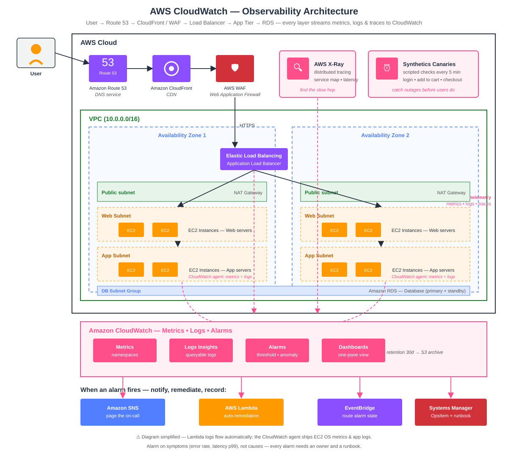

# AWS CloudWatch Observability Guide 📊


> **TL;DR:** CloudWatch is AWS's native observability service: it collects metrics, logs and traces from every AWS service and your own applications, turns them into alarms, dashboards and automated responses, and keeps the evidence you need when something breaks at 3 a.m. Master the three pillars — metrics, logs, traces — plus alarms that page the right person, and you stop guessing about production.

---

## Why CloudWatch Matters

| Problem | Without CloudWatch | With CloudWatch |
|---|---|---|
| "Is the app slow, or is it just me?" | Guess, or SSH into boxes and grep | One dashboard: latency, errors, saturation per service |
| "The disk filled up at 3 a.m." | You find out from angry users | Alarm on `disk_used_percent` pages you at 80%, not 100% |
| "What happened before the crash?" | Scattered log files on dead instances | Centralised logs, searchable with Logs Insights in seconds |
| "Which microservice is slow?" | Add print statements and redeploy | X-Ray traces show the exact slow hop across services |
| "Did the deploy break anything?" | Wait for support tickets | Alarm on error rate + automatic rollback via EventBridge |
| "Our CloudWatch bill exploded" | Pay for every log line forever | Retention policies, metric filters and log-class tiers |

## The Three Pillars (Plus Alarms)

```text
METRICS (numbers over time)          LOGS (events, text)             TRACES (requests end-to-end)
  • 1-min / 5-min granularity          • Log groups & streams           • X-Ray segments & subsegments
  • Namespaces: AWS/EC2, custom        • CloudWatch Logs Insights       • Service maps, latency breakdown
  • Math expressions, anomaly          • Metric filters: logs → metrics  • Sampling rules (cost control)
    detection, Contributor Insights    • Subscription filters → Lambda    • Annotations & metadata
              │                              │                                │
              └──────────────┬───────────────┴────────────────────────────────┘
                             ▼
                   ALARMS — thresholds, composite alarms, anomaly detection
                             │
              ┌──────────────┼──────────────────┐
              ▼              ▼                  ▼
        SNS notification  EventBridge rule   Systems Manager
        (email/Slack)     (auto-remediate)   (runbook / OpsItem)
```

**The golden rule:** metrics tell you *something* is wrong, logs tell you *what* happened, traces tell you *where* it went slow. You need all three — one pillar alone is a blind spot.

## Architecture



**Traffic / telemetry flow:** User → Route 53 → CloudFront / WAF → Application Load Balancer → EC2 app tier (private subnets across 2 AZs) → RDS. At the same time, every layer streams telemetry into CloudWatch: the CloudWatch agent on each EC2 instance ships OS metrics and application logs, the ALB and RDS publish native metrics, Lambda functions log automatically, and X-Ray traces requests end-to-end. Alarms evaluate the metrics and fire SNS notifications, trigger Lambda auto-remediation, or open Systems Manager OpsItems — while dashboards and Logs Insights give you the full picture in one place.

## Core Concepts

### 1. Metrics — numbers with dimensions

| Concept | What it means | Example |
|---|---|---|
| **Namespace** | A container for metrics (AWS service or your app) | `AWS/EC2`, `MyApp/Checkout` |
| **Dimension** | A key-value label that slices a metric | `InstanceId=i-abc`, `Environment=prod` |
| **Statistic** | How data points are aggregated over a period | `Average`, `p99`, `Sum`, `SampleCount` |
| **Resolution** | Standard (60 s) vs high-resolution (1 s, costs more) | Standard is enough for most alarms |
| **Metric Math** | Combine metrics in expressions (rates, ratios) | `errors / requests * 100` = error % |

```python
# Emit a custom metric — one line, no agent needed
cloudwatch.put_metric_data(
    Namespace="MyApp/Checkout",
    MetricData=[{
        "MetricName": "OrdersPlaced",
        "Dimensions": [{"Name": "Environment", "Value": "prod"}],
        "Value": 1, "Unit": "Count",
    }],
)
```

### 2. Logs — centralise everything, then query it

- **Log groups** (e.g. `/aws/lambda/checkout`) contain **log streams** (one per instance/container).
- **Retention:** set it explicitly — `Never Expire` is the default and the most common billing surprise. 30 days is a sane default; archive to S3 for compliance.
- **Logs Insights** is SQL-like querying over logs: find the 10 slowest requests, count errors by status code, spot the IP hammering your API.

```sql
-- Top 10 slowest requests in the last hour
fields @timestamp, @message
| filter @message like /duration=/
| parse @message "duration=*ms" as duration
| sort duration desc
| limit 10
```

### 3. Alarms — page on symptoms, not causes

| Alarm type | Use it for |
|---|---|
| **Threshold** | `CPUUtilization > 80% for 3 datapoints` — simple, predictable |
| **Anomaly detection** | Metrics with weekly seasonality (traffic) — no fixed threshold to guess |
| **Composite** | `ALARM(cpu) AND ALARM(errors)` — one page instead of two |
| **Metric Math alarm** | Error *rate* (`errors/requests > 1%`), not raw error count |

**Alerting discipline:** an alarm that fires weekly and gets ignored is worse than no alarm — it trains the team to ignore all of them. Every alarm needs an owner, a runbook link, and a severity (page vs ticket).

### 4. Traces & synthetics — see the whole request

- **X-Ray** draws a service map: ALB → EC2 → RDS, with latency per hop. The slow hop is obvious instead of a guess.
- **Synthetics canaries** run scripted checks (e.g. "log in and add to cart") every 5 minutes from multiple regions — they catch outages before users do.
- **RUM (Real User Monitoring)** shows what real browsers experience, including JavaScript errors and Core Web Vitals.

## CloudWatch vs the Alternatives

| | CloudWatch | Prometheus + Grafana | Datadog / New Relic |
|---|---|---|---|
| Setup | Zero — AWS services emit metrics natively | You run and scale it | Agent install, SaaS onboarding |
| AWS integration | Deepest (alarms → SNS/Lambda/SSM) | Via exporters | Good, but a second bill |
| Logs + traces | Built in (Logs Insights, X-Ray) | Loki / Tempo are add-ons | Built in |
| Cost model | Pay per metric, GB ingested, alarm | Infrastructure cost only | Per host, can get expensive fast |
| Best for | AWS-native workloads, compliance | Kubernetes, OSS-first teams | Multi-cloud, teams wanting one UI |

## Cost Control Checklist

- [ ] Set log retention (30 days default; S3 archive for long-term)
- [ ] Use **Infrequent Access** log class for logs you rarely query (cheaper ingestion)
- [ ] Delete unused custom metrics — each one bills per month, even idle
- [ ] Prefer **metric filters** over shipping every log line to Lambda
- [ ] Sample X-Ray traces (5–10% is usually enough) instead of tracing everything
- [ ] One dashboard per service, not one dashboard per metric

## Quick Start

```bash
# 1. Install the CloudWatch agent on EC2 (Amazon Linux 2023)
sudo yum install -y amazon-cloudwatch-agent
sudo /opt/aws/amazon-cloudwatch-agent/bin/amazon-cloudwatch-agent-ctl \
  -a fetch-config -m ec2 -c file:/opt/aws/amazon-cloudwatch-agent/etc/config.json -s

# 2. Run the demo (offline simulation, no AWS needed)
python3 cloudwatch_demo.py --demo

# 3. Run it live (needs boto3 + credentials with CloudWatch permissions)
pip install boto3
python3 cloudwatch_demo.py --live --region ap-southeast-1
```

## Project Structure

```text
aws-cloudwatch-observability-guide/
├── README.md                  # This guide
├── architecture.svg           # Classic AWS reference-style diagram
├── cloudwatch_demo.py         # Metrics, logs, alarms + offline simulation
└── quiz.md                    # 5 questions to test yourself
```

## Quiz Teaser

> **Q:** Your alarm fires every Monday at 09:00 when traffic spikes, and the team now ignores it. What's the *right* fix?
> **A:** See [quiz.md](quiz.md) — and no, the answer is not "delete the alarm". 😉

---

*Last updated: 2026-11-14*
